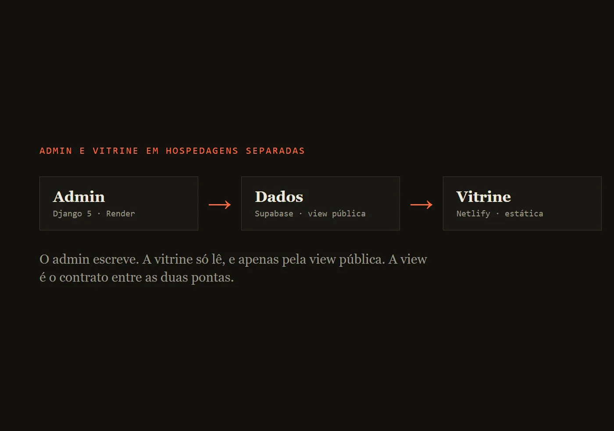
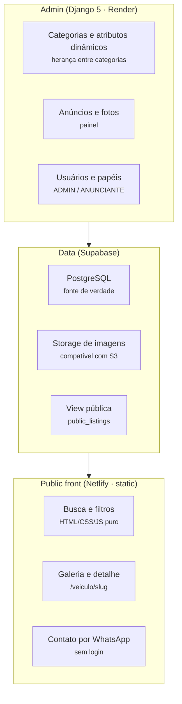

# JR Anúncios

> A classifieds platform with a Django admin and a static storefront on another service, linked by a data contract.

[Ler em português](README.md) · [See the other work in the portfolio](https://github.com/gabrieldacostarosa/portfolio)

| | |
|---|---|
| **Status** | Demo under maintenance |
| **My role** | Architecture, backend, front end and deploy. |
| **Stack** | `Python` `Django 5` `PostgreSQL` `Supabase` `Render` `Netlify` |

## Problem

Testing a production-style design where the admin panel and the public storefront live on different hosts and talk only through a data contract.

## Result

Dynamic categories and attributes with no code changes, 30 automated tests and a storefront isolated from admin failures.

## Screens

## Context and problem

I started with a vehicle classifieds site for a dealership (PFJ Veículos) and wanted to test a split you see in production: the admin panel on one host and the public storefront on another, talking only through a data contract. The goal was to find out what that takes in practice, and what each side gains and loses.

## What was built

- A Django 5 admin with hierarchical categories and fully dynamic attributes: new categories (real estate, motorcycles, electronics) are created in the panel, each with its own attributes, without changing code. Parent-category attributes are inherited by subcategories.
- The listing form and the filter engine are generated at runtime from those attributes; there is no `if category == "cars"` anywhere in the code.
- Administrator and advertiser roles with tested permissions, including an advertiser trying to edit another's listing. No public buyer sign-up.
- A static public storefront on Netlify, with search, filters, sorting, a gallery, a detail page and WhatsApp contact, reading listings through a public Supabase view.
- PostgreSQL in production, images in S3-compatible object storage, a view counter protected against repeat counting within a session, and a sitemap and robots file.

## Architecture

The admin writes; the front only reads, and only through the public view. The view is the contract between the two hosts.

## Decisions and trade-offs

| Decision | Why | Cost |
|---|---|---|
| Split the admin (Django) from the public storefront (static) | Netlify serves only static sites and functions, not a Django app. Splitting keeps the storefront fast, cheap and out of the admin's failure path. | Two deploys to keep in sync, and the front depends on the data contract staying stable. |
| Expose data through a view with only the public columns | The storefront never touches user tables or internal fields. Changing the internal schema won't break the front as long as the view holds. | The view must be versioned like an API and updated along with changes the public can see. |
| Dynamic attributes instead of fixed fields per category | Opening a new category becomes a configuration task, not a development task, and inheritance avoids duplicating attributes. | More generic queries and validation done at runtime instead of by the schema. |
| Images in external storage | Free-tier containers are ephemeral and lose uploaded files on restart. With object storage the admin host can be disposable. | One more dependency and credentials to configure. |
| No public sign-up and a discreet login | Only people who publish listings need an account. It reduces the attack surface and moderation work. | Buyers get no favorites or history. |

## Quality and security

- 30 automated tests: permissions, creating categories and attributes (including inheritance), the dynamic form, image upload, selection and range filters, search, pagination, the WhatsApp link and the view counter.
- Secrets kept out of the code: configuration through environment variables, with SQLite in development and PostgreSQL in production without changing code.
- Only the database's public key reaches the browser; writes happen only in the admin.

## What I would change

- Restore the Supabase connection, which is currently not responding, and publish the storefront link again. Until then this case stands as an architecture study.
- Document the view contract as a versioned API and test it automatically on every admin deploy.
- Reduce the admin's response delay: in my tests it was slow to respond, typical of free hosting that sleeps; a paid plan or a warm-up would fix it.

---

**All rights reserved.** This repository holds the project's documentation. The source code is private.
