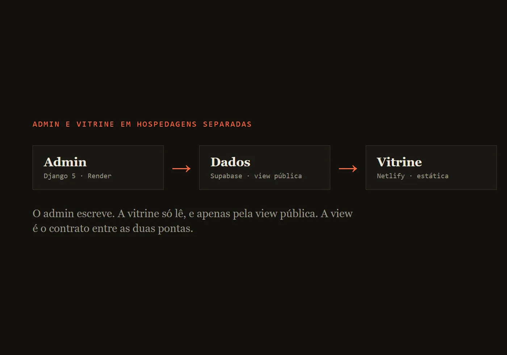
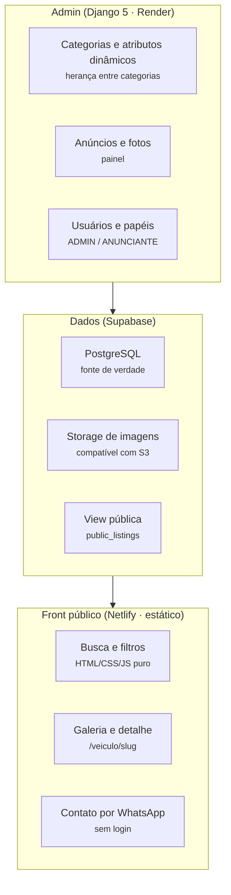

# JR Anúncios

> Plataforma de classificados com admin em Django e vitrine estática em outro serviço, ligados por um contrato de dados.

[Read in English](README.en.md) · [Veja os outros trabalhos no portfólio](https://github.com/gabrieldacostarosa/portfolio)

| | |
|---|---|
| **Situação** | Demo em manutenção |
| **Meu papel** | Arquitetura, backend, front-end e deploy. |
| **Stack** | `Python` `Django 5` `PostgreSQL` `Supabase` `Render` `Netlify` |

## Problema

Testar um desenho de produção em que o painel e a vitrine pública vivem em hospedagens diferentes e se falam só por um contrato de dados.

## Resultado

Categorias e atributos dinâmicos sem alterar código, 30 testes automatizados e a vitrine isolada das falhas do admin.

## Telas

## Contexto e problema

Comecei com um classificado de veículos para uma loja (PFJ Veículos) e quis testar uma separação que se vê em produção: o painel administrativo numa hospedagem e a vitrine pública em outra, conversando só por um contrato de dados. O objetivo era descobrir o que isso exige na prática, e o que cada lado ganha e perde.

## O que foi construído

- Admin em Django 5 com categorias hierárquicas e atributos totalmente dinâmicos: novas categorias (imóveis, motos, eletrônicos) são criadas pelo painel, cada uma com seus atributos, sem alterar código. Atributos da categoria-mãe são herdados pelas subcategorias.
- Formulário de anúncio e motor de filtros gerados em tempo de execução a partir desses atributos; não existe nenhum `if categoria == "carros"` no código.
- Papéis de administrador e anunciante com permissões testadas, inclusive um anunciante tentando editar anúncio de outro. Sem cadastro público de compradores.
- Vitrine pública estática no Netlify, com busca, filtros, ordenação, galeria, página de detalhe e contato por WhatsApp, lendo os anúncios por uma view pública do Supabase.
- Banco PostgreSQL em produção, imagens em armazenamento de objetos compatível com S3, contador de visualizações protegido contra contagem repetida na mesma sessão, e sitemap e robots.

## Arquitetura

O admin escreve; o front só lê, e apenas pela view pública. A view é o contrato entre as duas hospedagens.

## Decisões e trade-offs

| Decisão | Por quê | Custo |
|---|---|---|
| Separar o admin (Django) da vitrine pública (estática) | O Netlify serve só sites estáticos e funções, não um app Django. Separar deixa a vitrine rápida, barata e fora do caminho de falhas do admin. | Dois deploys para manter em sincronia, e o front depende de o contrato de dados continuar estável. |
| Expor os dados por uma view com só as colunas públicas | A vitrine nunca toca as tabelas de usuários nem campos internos. Mudar o schema interno não quebra o front enquanto a view se mantiver. | A view precisa ser versionada como uma API e atualizada junto com mudanças que o público enxerga. |
| Atributos dinâmicos em vez de campos fixos por categoria | Abrir uma categoria nova vira tarefa de configuração, não de desenvolvimento, e a herança evita duplicar atributos. | Consultas mais genéricas e validação feita em tempo de execução em vez de pelo schema. |
| Imagens em armazenamento externo | Containers de hospedagem gratuita são efêmeros e perdem arquivos enviados quando reiniciam. Com armazenamento de objetos, a hospedagem do admin pode ser descartável. | Mais uma dependência e configuração de credenciais. |
| Sem cadastro público e com login discreto | Só quem publica anúncio precisa de conta. Reduz a superfície de ataque e a moderação. | Compradores não têm favoritos nem histórico. |

## Qualidade e segurança

- 30 testes automatizados: permissões, criação de categorias e atributos (inclusive herança), formulário dinâmico, upload de imagem, filtros por seleção e por faixa, busca, paginação, link do WhatsApp e contador de visualizações.
- Segredos fora do código: configuração por variáveis de ambiente, com SQLite em desenvolvimento e PostgreSQL em produção sem trocar o código.
- No navegador vai só a chave pública do banco; escrita acontece apenas no admin.

## O que eu mudaria

- Restabelecer a conexão com o Supabase, que hoje não responde, e voltar a publicar o link da vitrine. Enquanto isso o caso fica como estudo de arquitetura.
- Documentar o contrato da view como API versionada e testá-lo automaticamente a cada deploy do admin.
- Reduzir a demora do admin: nos meus testes ele demorou a responder, comportamento típico de hospedagem gratuita que hiberna; um plano pago ou um aquecimento resolveria.

---

**Todos os direitos reservados.** Este repositório contém a documentação do projeto. O código-fonte é privado.
